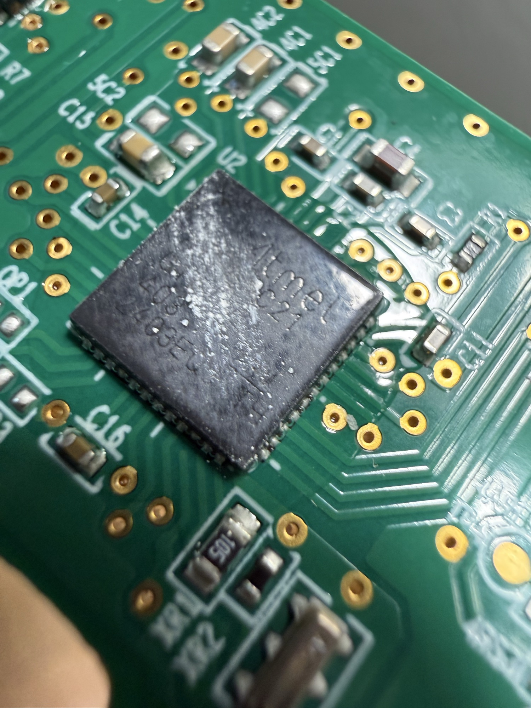
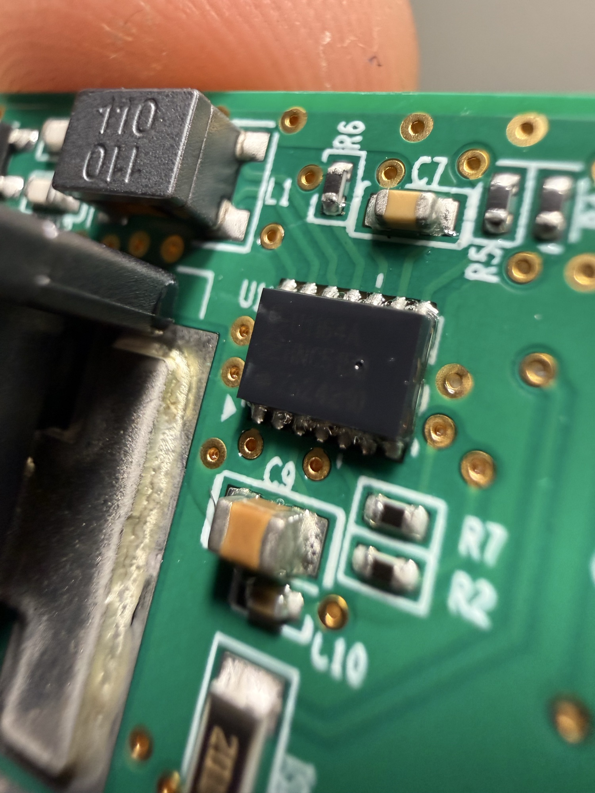

# Switch panel electronics

Board silkscreen: **IP-678A, 3022901 VER.1.00**. Button labels on the board
include `RVM/AVM` (reverse/surround camera button, `3SW1`). Housing label
starts `93310…`; OEM part for the XRT console switch is `93310-GIAB0-MEE`.

## ICs

The board has exactly two ICs.

### U2: Atmel microcontroller (QFN, ~48 pins)

| | |
|---|---|
|  |  |

- Marked `Atmel`; second line partly legible (`…21`), with lot/date lines
  partly obscured by residue (`…3BLQ3`, `…TH`). Full part number not yet read.
- Crystal `X1` and load parts (`XR1`, `XR2`) next to it.
- Best guess: an automotive AVR, possibly one of Atmel's LIN system-in-package
  parts (ATA6602/6603/6612/6613/6614), which combine an ATmega with a LIN
  transceiver and 5 V regulator in a 7x7 mm QFN48. Unconfirmed.
- To confirm: clean the top with isopropyl alcohol and photograph it under
  low-angle light, then compare against the datasheet marking tables.

### U1: SOIC-14

| | |
|---|---|
|  |  |

- Marking too faint to read in these photos.
- Sits next to an inductor (`L1`, marked `110`) and bulk capacitors, so it is
  probably the power stage (regulator) and/or the bus transceiver.
  Unconfirmed.

## CON2: 5-pin header and test points

- Unpopulated 5-hole through-hole header `CON2` with pin 1 marked by the
  triangle at `TP5`; test points `TP6` and others nearby.
- Most likely a factory programming/debug port for U2 (AVR ISP, debugWIRE or
  a UART). Map each pin to U2 with a continuity tester before connecting
  anything.

## What this means for the mod

A microcontroller on the panel means the Parking Safety button may **not**
appear on its own connector wire. The MCU could read the buttons locally and
report them over a LIN bus (one wire), and drive the LEDs from bus commands.
Fourteen wires argues against a bus-only panel, so it may be a mix of the two.

Next checks:

1. On the bench: follow the Parking Safety switch pads. Do they go to a U2 pin
   or straight to a connector pin?
2. In the car: look for a LIN signal (~12 V idle with fast dips to 0 V) on the
   connector, and note what changes when the button is pressed.
3. If the button only goes to U2, the simplest tap is across the switch pads on
   the PCB (emulate the press there), rather than on the harness.
