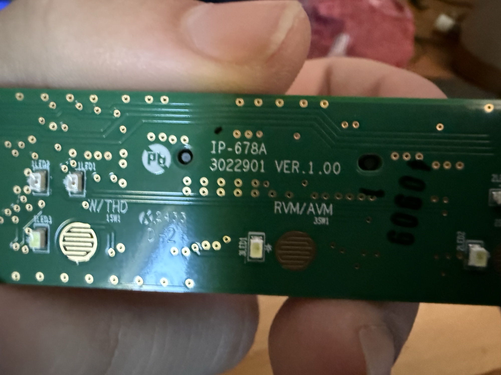
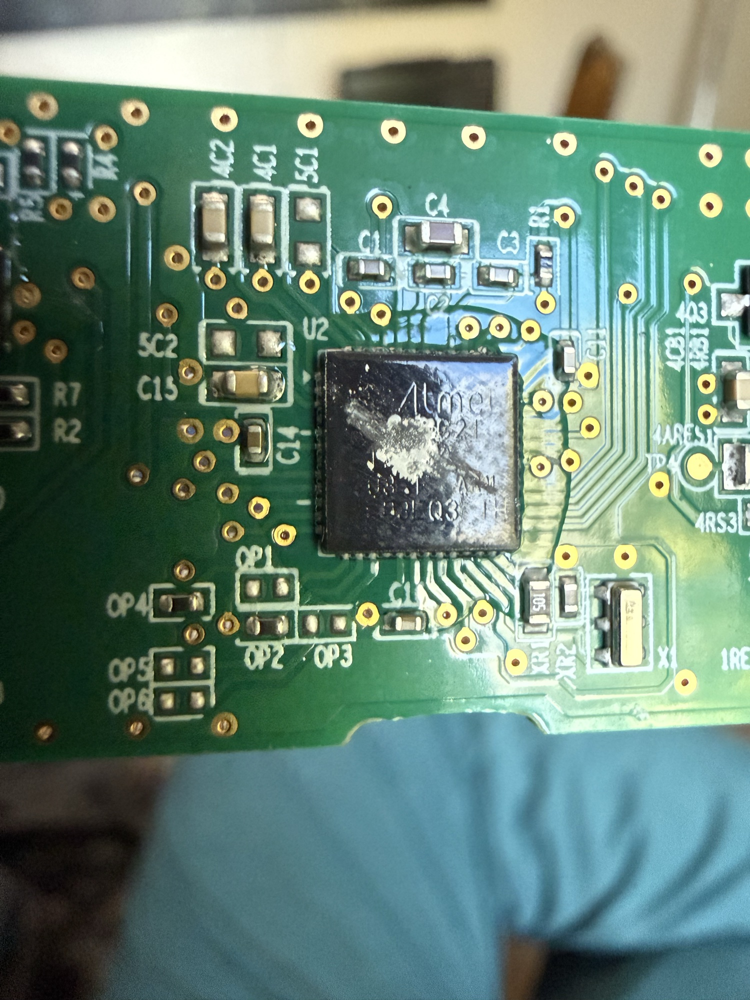
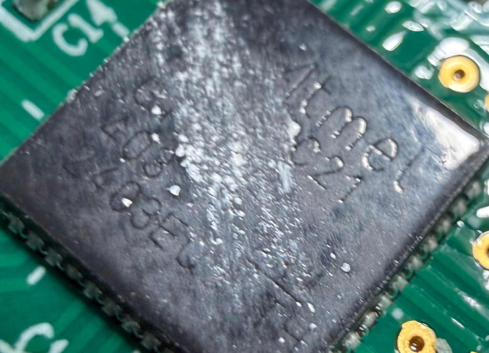
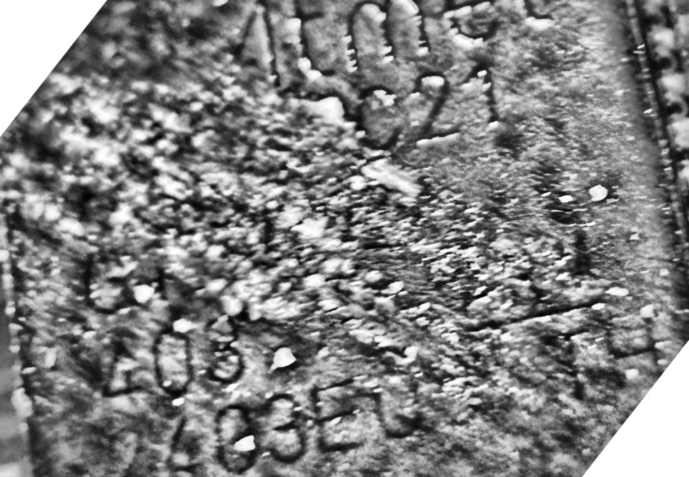
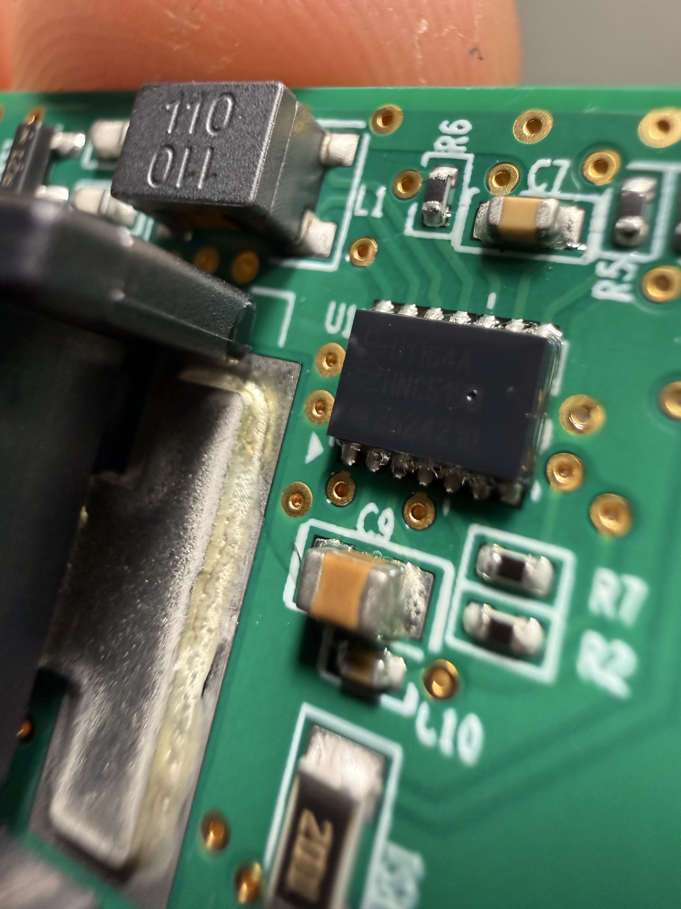
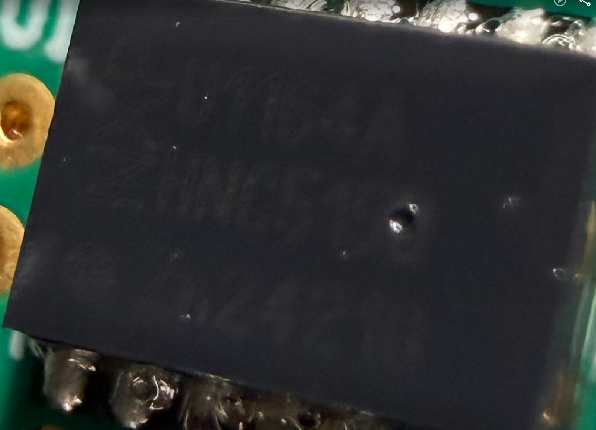
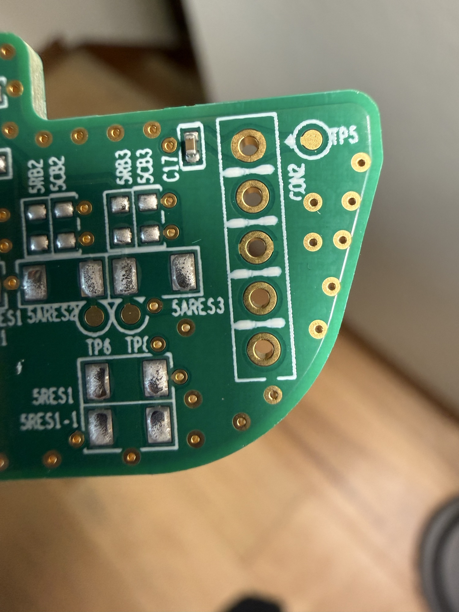

# Switch panel electronics

Board silkscreen: **IP-678A, 3022901 VER.1.00**. Button labels on the board
include `RVM/AVM` (reverse/surround camera button, `3SW1`). Housing label
starts `93310…`; OEM part for the XRT console switch is `93310-GIAB0-MEE`.



## ICs

The board has exactly two ICs.

### U2: Atmel ATSAMC21G17A (QFN48)

| | | |
|---|---|---|
|  |  |  |

Marking as read under better light (`?` = unreadable):

```
Atmel
????C21
GH????
403
2403EQ
```

An earlier photo also showed `ARM`.

- `…C21` plus `ARM` points to the **Atmel SAM C21**, a 5 V-tolerant automotive
  ARM Cortex-M0+ with on-chip CAN-FD controllers. That pairs naturally with
  the CAN chip in U1.
- **Confirmed: `ATSAMC21G17A-Z…`** (48 pins, 128 KB flash, 16 KB RAM). The
  `Z` suffix letter likely marks the automotive/125 °C grade.
- Runs from U1's V1 output, so the debug I/O is probably **5 V**. Measure
  CON2 pin 1 before connecting a probe.
- `2403EQ` and `403` are probably lot and date codes.
- Debug is 2-wire SWD: SWCLK on PA30 and SWDIO on PA31
  ([Microchip SWD pinout](https://onlinedocs.microchip.com/oxy/GUID-2BBF0A73-A043-4A40-A6CA-0FF154E4BFFE-en-US-8/GUID-6E157C8B-5346-4B90-937E-6BB12F591BF9.html)).
- Crystal `X1` and load parts (`XR1`, `XR2`) next to it.
- Earlier guesses (ATA66xx LIN chips, AT90CAN/ATmega M1) are superseded.

### U1: NXP UJA1164A CAN system basis chip (SO14)

| | |
|---|---|
|  |  |

Marking as read under better light:

```
NXP
U1164A
HN65150   (low confidence)
2624210
```

- `U1164A` is NXP's abbreviated marking for the **UJA1164A**, a high-speed
  CAN "mini system basis chip". It combines a CAN transceiver, a 5 V
  regulator that powers the MCU, a watchdog and standby/sleep handling, in
  SO14 ([UJA1164 summary](https://dtsheet.com/model/3708508)).
- SO14 pins from the UJA1164 datasheet: 1 TXD, 2 GND, 3 V1 (5 V output to the
  MCU), 4 RXD, 5 RSTN, 10 BAT, 12 **CANL**, 13 **CANH**. The A variant may
  differ on the SPI/config pins, so check the UJA1164A datasheet before
  relying on the rest.
- `L1` (4 pads, marked `110`) matches the TDK ACT1210-110 CAN common mode choke
  ([LCSC](https://www.lcsc.com/product-detail/C694257.html)), between U1's
  CANH/CANL and the connector.
- **Conclusion: the panel is a CAN node.** The Parking Safety press almost
  certainly leaves as a CAN frame.

To find the CAN pins on the connector (bench, unplugged):

1. Measured: L1 top goes to header pin 7, bottom to pin 8. Trace L1's other
   side to U1 pin 12 (CANL) / 13 (CANH) to tell which is which.
2. In the car, scope them: both ~2.5 V at idle, splitting to ~3.5 V / ~1.5 V
   during traffic.
3. Header pin 16 is ground. Still to map: U1 pin 10 (BAT) to the header.

## CON2: 5-pin header and test points



- Unpopulated 5-hole through-hole header `CON2` with pin 1 marked by the
  triangle at `TP5`; test points `TP6` and others nearby.
- Measured: pin 1 goes to a capacitor (likely VCC), pin 3 is GND. That fits
  the common 5-pin SWD order `1 VCC, 2 SWDIO, 3 GND, 4 SWCLK, 5 RESET`
  (the odd pins of the 10-pin Cortex header), but no single 5-pin standard
  exists. Confirm by
  continuity to U2: on the 48-pin SAM C21/D21 package, RESETN is pin 40,
  PA30/SWCLK pin 45, PA31/SWDIO pin 46 (check the C21 datasheet).
- The probe must handle 5 V I/O (J-Link, Atmel-ICE), or use a level shifter.
  A 3.3 V-only probe such as a bare Pico can be damaged.
- Automotive firmware is usually read-protected (security bit set), so a dump
  may not be possible. Never mass-erase: a chip-erase clears the protection
  but also wipes the firmware and bricks the panel.

## What this means for the mod

A microcontroller on the panel, behind a CAN system basis chip, means the
Parking Safety button probably does **not** have its own connector wire. The
MCU reads the buttons locally and reports them on the bus. The other wires
are probably power, ground, wake/ignition and backlight, plus any loads the
panel drives directly.

Being on CAN, this is likely the bus access the earlier OBD attempt could not get
past the security gateway: sniff these two pins, press Parking Safety, and
look for the frame that changes. Replaying a frame is still riskier than
emulating the button, so the simplest reliable tap remains across the switch
pads on the PCB.

Next checks:

1. On the bench: follow the Parking Safety switch pads. Do they go to a U2 pin
   or straight to a connector pin?
2. In the car: confirm CAN (or LIN, ~12 V idle with fast dips to 0 V) on the
   connector pins identified above.
3. If the button only goes to U2, the simplest tap is across the switch pads on
   the PCB (emulate the press there), rather than on the harness.
