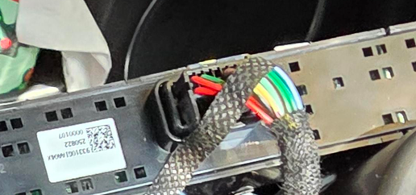

# Findings

Vehicle: 2025 Hyundai Ioniq 5 XRT (facelift, ccNC infotainment).

## Console teardown

Glossy upper console panel removal (from a 2026 Ioniq 5 owner, same facelift
console):
[r/Ioniq5 teardown with photos](https://www.reddit.com/r/Ioniq5/comments/1t76ayr/built_in_magsafe_phone_charger_without_exposed/)

1. Remove both cupholder rubber mats.
2. Remove the two screws, one under each mat.
3. Wide plastic trim tool under the front-centre edge; pry up to release
   roughly 6-8 clips.
4. Work around the edges and lift without stretching the connectors.

Disconnect the 12 V negative before unplugging connectors.

## Switch panel

- Assembly label starts `93310…`; OEM catalogue lists the XRT console switch
  as `93310-GIAB0-MEE`.
- Panel contents:
  - Seat heater buttons (2), each with 3 level LEDs
  - Steering-wheel heater button with 2 LEDs
  - Parking Safety button with 1 LED
  - Reverse/camera button, no LED
- Connector: **16 positions, 14 populated**. Housing maker/part number not yet
  identified (look for KET/KUM moulding on top, sides, latch).

### Interpretation

5 buttons + 9 LEDs = 14 signals, equal to the populated pin count, yet the
panel also needs ground and likely supply/backlight. So some signals share
wires (common grounds, grouped LEDs, or a resistor-ladder button input).
Fourteen wires is far too many for a CAN/LIN-only panel; expect discrete
switch and LED wiring. Older Ioniq 5 / 2024 Ioniq 6 diagrams show dedicated
`PDW SW SIG` and `PDW SW IND` circuits, consistent with this.

## Probing plan

Back-probe (do not pierce insulation), car on and in Park, scope ground on
verified chassis ground. Record each pin at idle, button held, > 2 s hold, and
after the feature toggles.

| Observation | Meaning |
|---|---|
| Steady voltage, drops to ~0 V only while pressed | Parking Safety switch signal |
| Intermediate level, shared with other buttons | Resistor ladder |
| Changes only when the feature toggles | Parking Safety LED |
| PWM that follows headlights/dimmer | Backlight |
| ~2.5 V pair splitting to ~3.5/1.5 V | CAN |
| ~12 V idle with fast dips | LIN |
| Constant 0 V / 12 V | Ground / supply |

Also measure, car off: switch-wire resting voltage and resistance to ground.

### Pin table (to fill in)

| Pin | Wire colour | Idle | Pressed | Toggled | Function |
|---|---|---|---|---|---|
| 1 | | | | | |
| 2 | | | | | |
| 3 | | | | | |
| 4 | | | | | |
| 5 | | | | | |
| 6 | | | | | |
| 7 | | | | | |
| 8 | | | | | |
| 9 | | | | | |
| 10 | | | | | |
| 11 | | | | | |
| 12 | | | | | |
| 13 | | | | | |
| 14 | | | | | |
| 15 | | | | | |
| 16 | | | | | |

## Proposed circuit (pending measurements)

- Ignition-switched supply tapped elsewhere; small MCU.
- Open-collector transistor or optocoupler from the switch wire to ground, in
  parallel with the factory button (if the switch is active-low; a resistor
  ladder needs a matching resistor instead).
- On startup: wait for the system to boot, read the LED line, press for ~3 s
  only if Parking Safety is on, confirm the LED changed, retry once.

## Interception options

1. Plug-in pass-through adapter (both connector halves; fully reversible).
   Needs the housing part number, a donor `93310-…` switch or Hyundai repair
   pigtail.
2. Single-wire tap on the switch signal (plus ground/IGN from elsewhere).
3. Back-probe piggyback - testing only.
