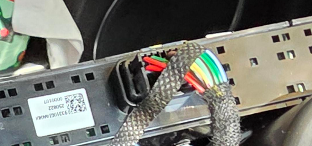
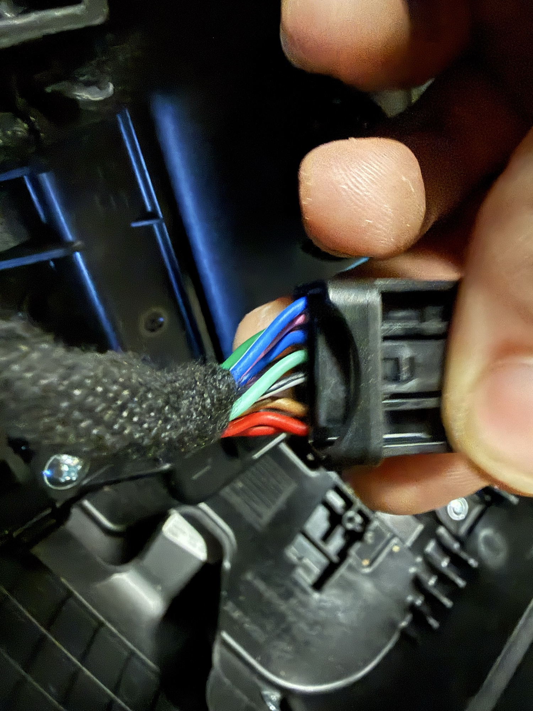
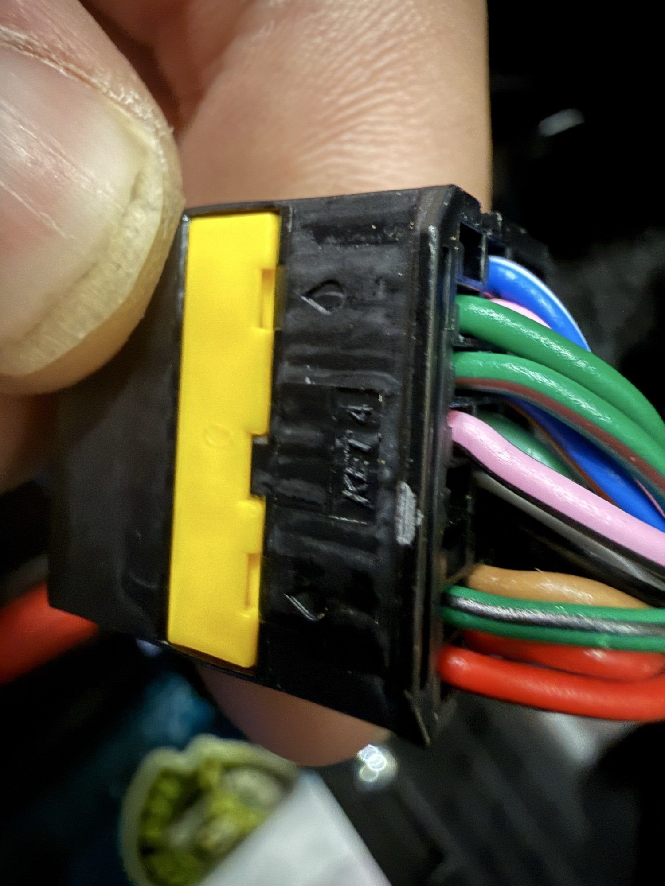
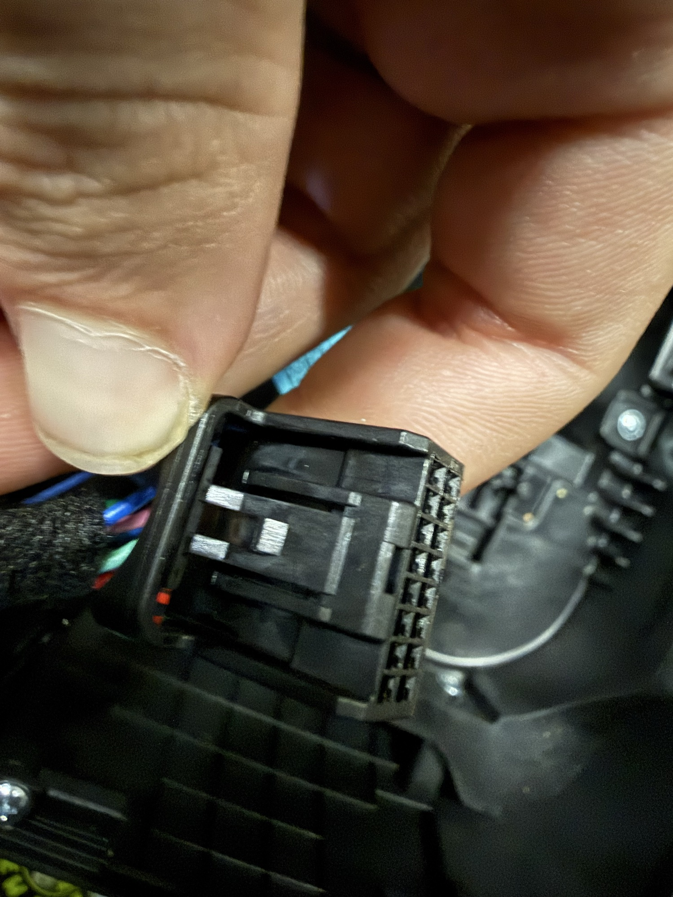
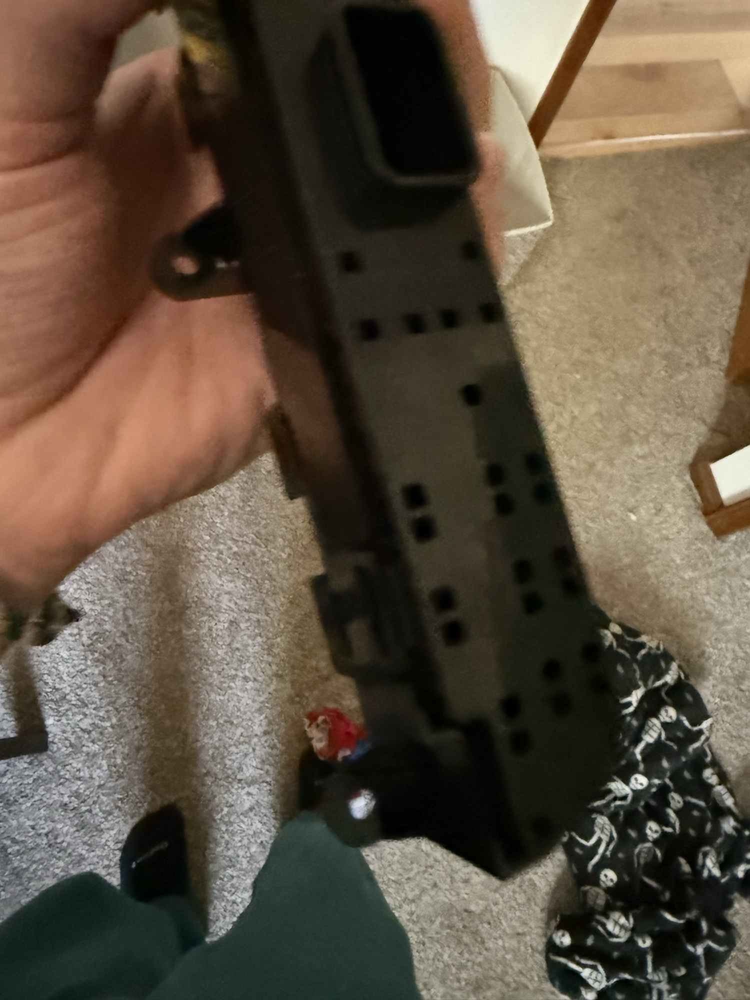
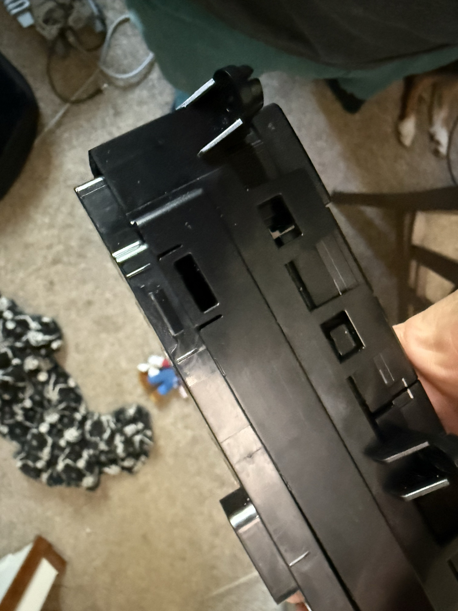

# Teardown: console switch panel

Vehicle: 2025 Ioniq 5 XRT (facelift console). Disconnect the 12 V negative
before unplugging connectors.

## 1. Remove the glossy upper console panel

Credit: the method comes from an r/Ioniq5 owner's
[MagSafe charger install post](https://www.reddit.com/r/Ioniq5/comments/1t76ayr/built_in_magsafe_phone_charger_without_exposed/),
which has photos of the screws and pry points. It works on the XRT.

1. Pull the rubber mats out of both cupholders.
2. Remove the two screws, one under each mat.
3. Slide a wide plastic trim tool under the front-centre edge of the glossy
   panel and pry up to release the clips (roughly 6-8).
4. Work around the edges and lift the panel without stretching the wiring.

## 2. Unplug the button assembly

Press the latch and pull the harness plug off the switch assembly. It is a
16-position KET plug (2 rows of 8, 14 wires populated) with a yellow
terminal-position lock.

| | |
|---|---|
|  |  |
| Connector in place | Harness plug unplugged |
|  |  |
| KET moulding, yellow lock | 16-pin header on the switch |

## 3. Remove the button assembly and open it

The assembly is held into the panel by four plastic clips around its edge.
Release them and pull it out. The PCB, rubber button membrane and a plastic
carrier then come out of the housing together.

| | |
|---|---|
|  |  |
| Assembly back | Edge clips |

Board details are in [electronics.md](electronics.md).
