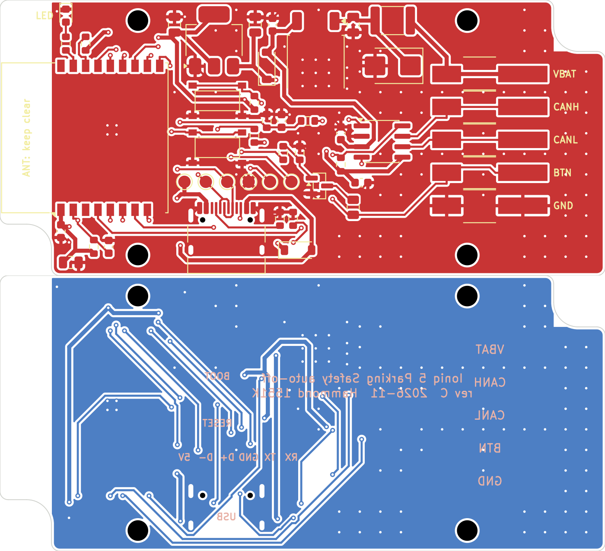
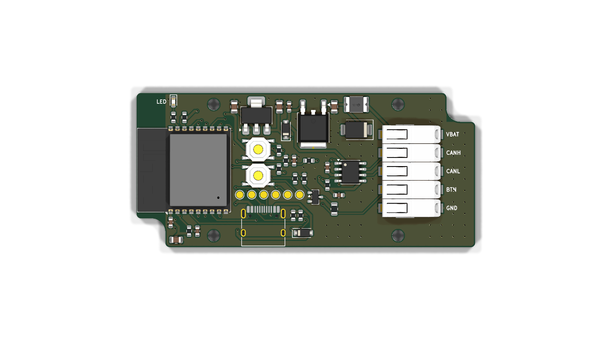
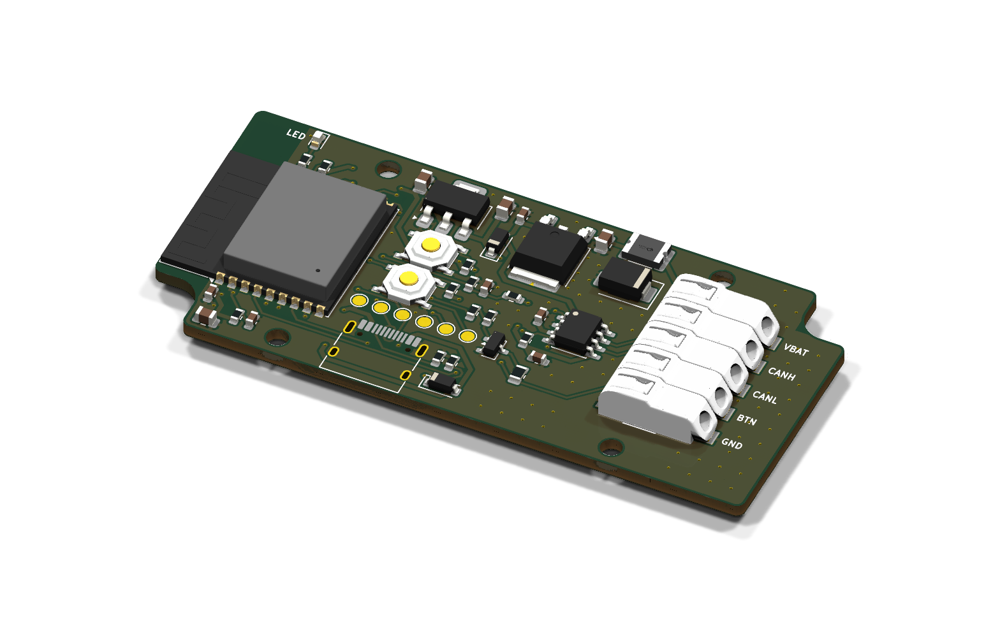

# ESP32-C3 add-on: Parking Safety auto-disable

KiCad 10 schematic and PCB for the add-on board that taps the console switch panel
(CON1 of PCB IP-678A, see [../../docs/electronics.md](../../docs/electronics.md))
and presses the Parking Safety button at startup based on CAN status.

PDF: [out/esp32c3-recovery.pdf](out/esp32c3-recovery.pdf)

## Files

| File | What |
|---|---|
| `esp32c3-recovery.kicad_pro` / `.kicad_sch` | KiCad project and the single sheet |
| `esp32c3_recovery.kicad_sym` + `sym-lib-table` | Project symbol library (empty: every symbol is stock KiCad) |
| `tools/gen.py` | Generates the sheet and project library; **edit this, not the sheet** |
| `tools/check.sh` | Regenerate, ERC, netlist check against intended nets, library check, PDF/SVG/PNG export |
| `esp32c3-recovery.kicad_pcb` | The routed board (generated; **edit `tools/gen_pcb.py`**) |
| `esp32c3_recovery.pretty/` + `fp-lib-table` | Project footprints from `tools/footprints.py`: WROOM-02 (stock minus its 0.2 mm vias), WAGO 2060, TS-1187A switch |
| `esp32c3_recovery.3dshapes/` | 3D models for the WAGO, the switch and F1 (sources below) |
| `tools/gen_pcb.py` | Placement (`PLACE`), keep-outs, ground pours, stitching vias, JLC BOM/CPL |
| `tools/pcb.sh` | Full PCB build: schematic checks, place, Freerouting, pours, DRC, JLC outputs |
| `out/jlc/` | Upload set: `*-gerbers.zip`, `*-bom.csv`, `*-cpl.csv` |

Everything else uses stock KiCad symbols and footprints. Each JLC-assembled
part carries `Footprint` and `LCSC` fields.

## PCB

Sized for a **Hammond 1551K** box (1551KBK black, 1551KTBU translucent blue;
80 x 40 x 20 mm ABS). The outline is Hammond's maximum board size (74 x 34 mm,
with 6.25 mm notches at the top-right and bottom-left corners for the lid-screw
posts), shrunk by 0.25 mm on every side: 73.5 x 33.5 mm. Corners are rounded
R1, and the two inside notch corners R3 (Hammond's radius). 2 layers, 1.6 mm,
every part JLC-placed on the top side (Economic PCBA), including the ESP32-C3
module: nothing to hand-solder. DRC is clean (0 violations, 0 unconnected,
schematic parity OK).

- **Mounting: four 2.5 mm non-plated holes on a 40 x 28.5 mm rectangle.**
  - **H1 (top left) and H2 (bottom right) sit on the box's two PCB bosses.**
    Hammond puts them 17 mm from the left edge and 2.75 mm from the top of
    its maximum board, which is board (16.75, 2.5) here. Use Hammond's
    #2 x 3/16" self-tapping PCB screws (1551ATS100).
  - **H3 (top right) and H4 (bottom left)** complete the rectangle for bench
    standoffs; nothing sits under them in the box. 2.5 mm is tight for M2.5,
    so use M2 screws or standoffs there.
  - No top-layer tracks or vias within 2.7 mm of H1/H2, so the box screws'
    heads sit only on the ground pour. The board sits
  4 mm off the floor and the tallest part (the WAGOs, 4.5 mm) clears the lid by
  about 5.9 mm.
- **U2 is an ESP32-C3-WROOM-02-N4** (C2934560, 18 x 20 mm, 4 MB flash, PCB
  antenna, -40 to 85 C), placed by JLC. It lies on its side with the antenna
  end at the left edge, so Espressif's keep-out (5 mm round the antenna, in
  KiCad's footprint) covers the left 6.3 mm of the board and runs off the
  edge. Pins 10-18 (IO10..IO0) run along the top, 1-9 (3V3, EN, IO4..IO9,
  GND) along the bottom.
  - The project footprint is KiCad's stock one without its twelve 0.2 mm
    vias in the ground pad (JLC's standard minimum drill is 0.3 mm); five
    0.3 mm vias take their place.
  - No top-layer tracks under the module inside its pad rows.
  - The nearest screw to the antenna is H1's, about 10 mm from the antenna
    end.
- **3.3 V:** U4 AMS1117-3.3 from +5V (about 0.1 W), C7 22u at its output and
  C8 100n at the module's 3V3 pin. The L78M05 still makes 5V_REG for the
  TJA1051.
- **Reset, boot, strapping:** R8 10k + C9 1u on EN (power-on delay), SW2
  RESET and SW1 BOOT (TS-1187A, JLC basic), and 10k pull-ups on GPIO9, GPIO8
  and GPIO2. For the ROM bootloader, hold BOOT and tap RESET.
- **USB and debug pads:** J6 USB-C (HRO TYPE-C-31-M-12, C165948) with 5.1k
  CC pull-downs R12/R13, fitted by JLC, on the module's native USB
  (GPIO18/19). The cable plugs in from the board's bottom edge, which faces a
  long wall in the box. Next to it are bare test pads:
  - TP1 5V (VBUS), TP2 D-, TP3 D+, TP4 GND: the same native USB, for a
    pogo-pin or tack-soldered cable;
  - TP5 TX, TP6 RX: UART0, where the firmware logs.
  - VBUS reaches +5V through D4, so USB alone runs the board (the TJA1051
    stays off the bus without 12 V). The labels are on the bottom silkscreen.
- **J1-J5 are WAGO 2060-451/998-404 push-in terminals**, one per wire, wire
  entry facing the right end wall. From the top: VBAT, CANH, CANL, BTN, GND,
  printed at each entry on the top and under each terminal on the bottom.
  - The entry faces sit about 7.5 mm in from the board edge, about 8.3 mm
    from the box's inner wall. J1 and J5 are 8 mm either side of centre, so
    wires from one central hole can't enter them straight on. Either thread
    the harness through the end-wall hole, wire the board outside the box,
    then lower it in, or cut a U-slot down from the rim of the right end wall.
    The hole centre should be about 9.5 mm above the outside bottom (a guess
    from the 3D model). Thin wire (22-24 AWG) makes the fan-out easier.
  - GND is the terminal next to H2's screw.
  - Wire: 0.2-0.75 mm2 (24-18 AWG) solid, or stranded with the release button
    pressed, stripped 7-9 mm. Ferrules only for 0.25-0.34 mm2. Don't tin
    stranded wire.
  - The footprint follows WAGO's land pattern (data sheet 11.02.2026): 14 mm
    overall, a 6 mm pad under the conductor entry, a 3.5 mm pad at the back,
    and 2.0 mm wide (the 1.2 mm contact tail plus 0.4 mm each side).
  - Each terminal is held by its two solder pads only. Tie the harness down
    to the box (a cable tie through the grommet), and optionally put a bead of
    RTV across the five bodies after wiring.
- **D3, user LED:** red 0603 LED on GPIO1 (active high, ~1.3 mA through R7
  1k), at the top-left corner, board (8.0, 1.9) from the top-left corner. The
  box is opaque, so drill a ~2 mm hole in the lid above it. The translucent
  1551KTBU may also work, but blue plastic dims red light.
- **Regulator heat:** the DPAK tab connects solid to the top ground pour, with
  9 vias in the tab plus a ring beside it into the bottom pour.
- **Rules:** power nets (VBAT, 5V_REG, +5V, +3V3) use 0.5 mm tracks, other nets
  0.25 mm. GND is routed at 0.25 mm too; the pours on both layers carry
  its current. Clearance is 0.2 mm, vias 0.6/0.3 mm, copper-to-edge 0.3 mm or more.

**3D models** (`esp32c3_recovery.3dshapes/`, used unmodified; the footprints set the offset and rotation):
- `WAGO_2060-451_998-404.step`: the EasyEDA/LCSC model for C2765054, fetched
  with `easyeda2kicad --3d --lcsc_id=C2765054`.
- `Fuse_1812_4532Metric.step`: the EasyEDA/LCSC model for C70113 (F1), fetched
  the same way. KiCad ships none for that footprint; `MODEL_OVERRIDE` in
  `tools/gen_pcb.py` swaps it in.
- `SW_TS-1187A.step`: the EasyEDA/LCSC model for C318884 (SW1, SW2), with
  its footprint pads taken from JLC's footprint.
- All other parts, including the WROOM-02, use KiCad's stock models.

**Rebuild:** `JAVA=<java 25+> FREEROUTING=<freerouting-2.x.jar> tools/pcb.sh`.
`pcb.sh` re-runs Freerouting while its result changes. If a change leaves
unconnected pads, adjust `PLACE`; check two-terminal parts' pad 1 orientation
first.

### Before ordering

- **Check the fit against a real 1551K** if one is on hand: the hole positions
  and the corner notches come from Hammond's drawing (REV 31.08.2023), not a
  measured box.
- **Tick "Confirm Parts Placement" when ordering**, and check every part in
  JLC's placement preview: the polarity of U3 (pin 1), Q1, U1, D1, D2, D3 and
  D4, and the WAGO orientation, with the wire entry (6 mm pad) facing the
  right edge.
  - **New since the last preview check:** U2 (the module: antenna end at the
    left edge, pin 1 bottom-left), U4 (SOT-223, tab toward the top edge) and
    SW1/SW2. JLCKicadTools has no entry for the WROOM-02; the CPL uses
    KiCad's rotation, so correct it in the preview if JLC's model is turned.
  - The CPL adds SOIC +270, SOT-23 +180 and SOT-223 +180. The SOT-23 value
    comes from JLC's own preview on 2026-11-17, which showed Q1 90 degrees off
    with the JLCKicadTools -90. That preview also showed U1, D1, D2, D3, F1,
    U3 and the WAGOs correct.
- **WAGO position:** JLC's own footprint for C2765054 has its origin 0.57 mm
  toward the back pad from ours. The CPL reports that point, so JLC's part
  lands centred on our pads. If the preview still shows the terminals shifted
  along their length, correct it there.
- **Economic assembly:** JLC's part pages list "Economic and Standard" for
  the module C2934560, the WAGO C2765054, F1 C70113, U3 C38695, U4 C6186
  and D1 C19077573 (checked 2026-11-17). Order five WAGOs per board.
- Gerbers, drill files and the CPL share the bounding box's lower-left corner
  as origin.

## BOM (JLCPCB assembly)

Every part is placed by JLC (J6's shell pegs are through-hole, soldered in the
same pass); the test pads are bare copper. Part status was checked
against JLC's parts API on 2026-11-16/17.
Basic and preferred parts carry no feeder fee on Economic PCBA. Each plain
extended part type adds about $3 per order.

| Ref | Part | Package | LCSC | JLC status |
|---|---|---|---|---|
| R1, R7 | 1k | 0603 | C21190 | basic |
| R2, R8, R9, R10, R11 | 10k | 0603 | C25804 | basic |
| R3 | 200 | 0805 | C17540 | basic |
| R4 | 100k | 0603 | C25803 | basic |
| R5 | 27k | 0603 | C22967 | basic |
| R6 | 4.7k | 0603 | C23162 | basic |
| C1 | 1u 50V X7R | 0805 | C28323 | basic |
| C2, C4, C5, C6, C8 | 100n 50V X7R | 0603 | C14663 | basic |
| C3, C7 | 22u 25V X5R | 0805 | C45783 | basic |
| C9 | 1u 50V X5R | 0603 | C15849 | basic |
| U4 | AMS1117-3.3 | SOT-223 | C6186 | basic |
| SW1, SW2 | TS-1187A-B-A-B tactile switch | 5.1 x 5.1 mm SMD | C318884 | basic |
| U1 | L78M05ABDT-TR | DPAK | C58069 | basic |
| D2, D4 | B5819W | SOD-123 | C8598 | basic |
| Q1 | MMBT3904 | SOT-23 | C20526 | basic |
| D1 | SMBJ18A | SMB | C19077573 | preferred (no basic TVS exists) |
| U3 | TJA1051T/3/1J | SOIC-8 | C38695 | extended (no basic CAN transceiver exists) |
| F1 | mSMD050-60V | 1812 | C70113 | extended (no basic or preferred PTC exists) |
| J1-J5 | WAGO 2060-451/998-404 (x5) | SMD terminal | C2765054 | extended (one part type, one fee) |
| D3 | KT-0603R red LED | 0603 | C2286 | basic |
| U2 | ESP32-C3-WROOM-02-N4 | 18 x 20 mm module | C2934560 | extended |
| J6 | USB-C, HRO TYPE-C-31-M-12 | SMD + THT shell | C165948 | extended |
| R12, R13 | 5.1k | 0603 | C23186 | basic |

Five extended part types (U2, U3, F1, J1-J5, J6): about $15 in feeder fees per
order.

**CAN transceiver.** JLC has no basic CAN transceiver. Two are preferred
(fee-free). TJA1050T (C6952) needs 5 V, outputs 5 V on RXD and has no silent
pin, so it doesn't fit. SN65HVD230DR (C12084) runs on 3.3 V, and its RS-high
standby mode is a true listen-only mode (driver off, receiver unchanged), so it
would work with the same firmware. It is not used here because its bus pins
are rated only -4 to +16 V absolute maximum and it is rated to 85 C. The
TJA1051T/3 is the chip on the Adafruit CAN Pal. It is AEC-Q100, with -58 to
+58 V bus pins and the same S (silent) pin, for about $0.55 plus one
extended-part fee.

## Pin map (ESP32-C3-WROOM-02)

| GPIO | Use |
|---|---|
| GPIO3 (ADC) | Press sense: BTN through 100k/27k divider, ~1 V threshold |
| GPIO5 | TJA1051 S (silent). R6 4.7k pull-up keeps the transceiver silent; firmware drives it high by default |
| GPIO6 | TJA1051 TXD (transmit possible, but off by default) |
| GPIO7 | TJA1051 RXD |
| GPIO10 | Button press drive on CON1-5 (1k to MMBT3904 base, 10k base pull-down) |
| GPIO1 | D3 user LED (active high, R7 1k) |
| GPIO2/8/9 | Strapping pins: 10k pull-ups; SW1 BOOT pulls GPIO9 low |
| GPIO18/19 | Native USB D-/D+ (J6, TP2/TP3) |
| GPIO20/21 | UART0 RX/TX (TP6/TP5), firmware log |
| EN | 10k/1u reset delay, SW2 RESET |

## Assumptions to verify before building

- **BTN line = CON1 pin 5.** The Parking Safety switch is hardwired there
  (~200 ohms in series, other side to ground; not read by the panel MCU) and
  pin 5 idles at 12.2 V in the car. See docs/findings.md. Measured in the car
  with the firmware running: GPIO3 reads ~2.5 V released (BTN ~11.8 V) and
  ~0.1 V with Q1 on (BTN ~0.5 V), so R3 = 200 ohms (mirroring the factory switch
  path) carries at most ~2.4 mA.
- **R3 is now 0805 (125 mW), down from 1 W.** Against the panel's weak (~5k)
  pull-up it dissipates about 1 mW. The 1 W rating only covered a stiff 12 V
  source on BTN (0.7 W), which the in-car readings rule out. There is no basic
  1206 at 200 ohms (C18002, 0.25 W, is extended).
- **Regulator:** L78M05 in DPAK (35 V max in, above the SMBJ18A's 29.2 V
  clamp). It has no reverse-battery protection, but the tap is behind the
  panel's D1/D2. At 14.4 V in and ~80 mA average (more in Wi-Fi bursts) it
  dissipates ~0.75 W, so give the DPAK tab a copper pour of a few cm^2.
- **Transceiver supply:** TJA1051 VCC (4.5-5.5 V) is fed from `5V_REG`
  before D2, because the Schottky drop on `+5V` can fall below 4.5 V. On USB
  power alone the transceiver sees VCC under-voltage and disengages from the
  bus (zero load), so there is no CAN receive on the bench without 12 V.
  VIO is the board's 3.3 V (U4), so RXD is 3.3 V logic.
- **No CAN termination** on this board: the tap sits mid-bus.
- **Parts added after the design review:** F1 PTC fuse, which limits fault
  current if the TVS fails short. D2 Schottky, which stops USB 5 V from
  back-feeding the regulator; D4 does the same the other way, so the 12 V
  supply can't push current into a USB host.
