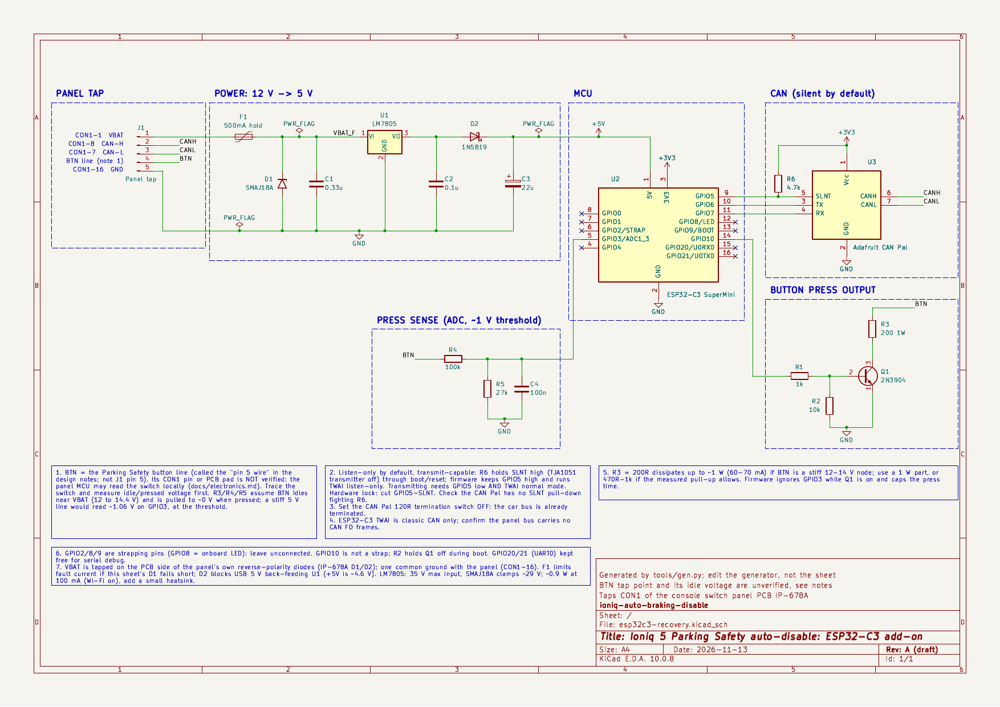

# ESP32-C3 add-on: Parking Safety auto-disable

KiCad 10 schematic for the add-on board that taps the console switch panel
(CON1 of PCB IP-678A, see [../../docs/electronics.md](../../docs/electronics.md))
and presses the Parking Safety button at startup based on CAN status.

PDF: [out/esp32c3-recovery.pdf](out/esp32c3-recovery.pdf)

## Files

| File | What |
|---|---|
| `esp32c3-recovery.kicad_pro` / `.kicad_sch` | KiCad project and the single sheet |
| `esp32c3_recovery.kicad_sym` + `sym-lib-table` | Project symbols: ESP32-C3 SuperMini, Adafruit CAN Pal (no stock symbols exist) |
| `tools/gen.py` | Generates the sheet and project library; **edit this, not the sheet** |
| `tools/check.sh` | Regenerate, ERC, netlist check against intended nets, library check, PDF/SVG/PNG export |

Everything else uses stock KiCad symbols (LM7805_TO220, SMAJ18A, 1N5819,
2N3904, Polyfuse, R/C, Conn_01x05_Pin, power symbols).

## Pin map (ESP32-C3 SuperMini)

| GPIO | Use |
|---|---|
| GPIO3 (ADC) | Press sense: BTN through 100k/27k divider, ~1 V threshold |
| GPIO5 | CAN Pal SLNT. 4.7k pull-up keeps the transceiver silent; firmware drives it high by default |
| GPIO6 | CAN Pal TX (transmit possible, but off by default) |
| GPIO7 | CAN Pal RX |
| GPIO10 | Button press drive (1k to 2N3904 base, 10k base pull-down) |
| GPIO2/8/9 | Strapping pins (GPIO8 = LED): unused |
| GPIO20/21 | UART0, kept free for serial debug |

## Assumptions to verify before building

- **BTN line.** The schematic calls it the Parking Safety button line, the
  "pin 5 wire" from the design chat. Its actual CON1 pin or PCB pad is not
  verified, and the panel MCU may read the switch locally. The R3/R4/R5
  values assume BTN idles near VBAT (12 to 14.4 V) and is pulled to ~0 V when
  pressed.
- **Regulator:** LM7805 (stock symbol) instead of the LM2940 from the design
  chat. It has no reverse-battery protection, but the tap is behind the
  panel's D1/D2. Its 35 V max input sits above the SMAJ18A clamp (~29 V).
- **Parts added after the design review:** F1 PTC fuse, which limits fault
  current if the TVS fails short. D2 Schottky, which stops USB 5 V from
  back-feeding the regulator.
- **CAN Pal:** termination switch OFF. Check that nothing on the board pulls
  SLNT low against R6.
- **SuperMini pin numbers** follow the common header order (left 5V, GND,
  3V3, GPIO4..0; right GPIO5..10, 20, 21). Check them against your board's
  silkscreen.
